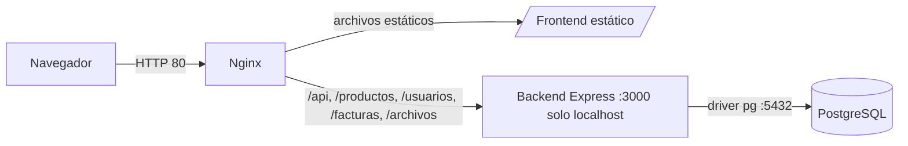

# PokéVault — SecurityProyect_2026

Tienda web de cartas y sobres Pokémon con publicaciones de la comunidad, desarrollada
para el curso **Seguridad en Entorno de Desarrollo** (UCA). La aplicación se despliega en
una VM con Linux Server e incluye **dos vulnerabilidades introducidas a propósito y
documentadas** (sección 5) sobre una base endurecida.

> Universidad Centroamericana "José Simeón Cañas" — Facultad de Ingeniería y Arquitectura
> Curso: Seguridad en Entorno de Desarrollo, ciclo 02/2026.

## Equipo

| Integrante | Usuario GitHub | Carné |
|---|---|---|
| Jaime Antonio Pérez Shupan | `Anthony1347P` | 00202124 |
| David Alessandro Ventura Montoya | `David-Ventura24` | 00089724 |
| Juan Carlos Rivera Meléndez | `Juan-CRivera` | 00029324 |
| Samuel Alejandro Pérez Hernández | `SamuelPerez8258` | 00052424 |
| Diego Pérez Herrera | `DiegoIPH` | 00543924 |

## 1. Descripción y roles

La aplicación permite publicar, revisar y comprar cartas de colección. El acceso a cada
vista está restringido por rol y requiere autenticación.

| Rol | Qué puede hacer |
|---|---|
| **Comprador** | Ver el catálogo y la comunidad, comprar, generar su factura y avisar el pago |
| **Vendedor** | Lo del comprador, más publicar cartas en la comunidad (quedan en revisión) |
| **Administrador** | CRUD completo de productos y de usuarios, moderar publicaciones y conciliar pagos |

Vistas: `index`, `login`, `registro`, `vender`, `comunidad`, `carrito`, `perfil`,
`admin` y `contacto`.

## 2. Arquitectura

**Tecnologías**

- **Backend:** Node.js + Express 5, con el driver `pg` directo a PostgreSQL (sin ORM).
- **Autenticación:** contraseñas con `argon2`, sesión con JWT (HS256) en cookie `httpOnly`.
- **Frontend:** sitio estático HTML/CSS/JS.
- **Servidor web:** Nginx como proxy inverso y servidor del frontend.
- **Base de datos:** PostgreSQL.

**Diagrama**



**Estructura del repositorio**

```
SecurityProyect_2026/
├── backend/
│   ├── index.js              # Express: CORS, cabeceras, registro de rutas
│   ├── db.js                 # pool de PostgreSQL
│   ├── lib/validar.js        # validación de entradas (anti XSS/inyección)
│   ├── middleware/
│   │   ├── auth.js           # requireAuth, requireRole, sesionOpcional
│   │   └── rateLimit.js      # límite de intentos de login
│   ├── routes/
│   │   ├── auth.js           # /register, /api/login, /api/me, /api/logout
│   │   ├── productos.js      # CRUD de publicaciones
│   │   ├── archivos.js       # subida de fotos (/archivos)
│   │   ├── usuarios.js       # CRUD de usuarios (admin)
│   │   └── facturas.js       # compra, aviso de pago y conciliación
│   └── db/                   # scripts .sql (esquema, datos de prueba, migraciones)
├── Frontend/                 # sitio estático (vistas + js + uploads)
├── desplegar.sh              # instalación y hardening del servidor
└── README.md
```

**Base de datos (tablas principales):** `users`, `productos`, `orders`, `order_items`,
`invoices`, además de `expansions`, `booster_packs`, `carts` y `cart_items`.

## 3. Instalación desde cero

Pensada para una VM con **Ubuntu Server 24.04** (también funciona en Debian y en
CentOS Stream / Rocky / Alma: el script detecta la distro). Despliegue **local**, sin
exposición a internet.

**3.1 Crear la VM (VirtualBox)**

1. Nueva VM: tipo Linux, **2 CPU**, **2–4 GB de RAM**, **20 GB de disco**.
2. Instalar Ubuntu Server 24.04 desde el ISO; marcar **OpenSSH server** durante la instalación.
3. Red: adaptador en **Bridged** (puente), para que otra máquina de la red la alcance.

**3.2 Desplegar**

Dentro de la VM, con un usuario con `sudo`:

```bash
git clone https://github.com/SamuelPerez8258/SecurityProyect_2026.git
cd SecurityProyect_2026
sudo bash desplegar.sh
```

El script instala y configura todo solo: Node.js, PostgreSQL y Nginx; crea la base de
datos con sus tablas, el catálogo inicial y los usuarios de prueba; genera el `.env`
(con un `JWT_SECRET` y una contraseña de BD aleatorios); levanta el backend como servicio
`systemd`; configura Nginx; y aplica el hardening del servidor (firewall UFW, SSH,
cabeceras de seguridad y permisos mínimos de la BD).

Al terminar imprime la IP. Se abre en el navegador de otra máquina de la red:

```
http://IP_DE_LA_VM
```

**Opciones útiles**

- `sudo RESET_DB=1 bash desplegar.sh` — borra la base y la vuelve a cargar.
- `sudo FIREWALL=0 HARDEN_SSH=0 bash desplegar.sh` — no toca el firewall ni el SSH.
- Logs del backend: `sudo journalctl -u pokevault -f`.

## 4. Usuarios de prueba

| Rol | Correo | Contraseña |
|---|---|---|
| Administrador | `admin@pokevault.local` | `Admin12345` |
| Vendedor | `vendedor@pokevault.local` | `Vendedor123` |
| Comprador | `comprador@pokevault.local` | `Comprador123` |

## 5. Vulnerabilidades introducidas a propósito

Se introdujeron dos, una de código y una de servidor, ambas explotables, reproducibles y
marcadas en el código con el comentario `VULN`. El resto de la aplicación está endurecido.

> La explicación detallada, con requerimientos, infraestructura y los pasos de explotación,
> está en **[PLAYBOOK.md](PLAYBOOK.md)**.

### 5.1 IDOR — Referencia directa a objeto insegura (código)

- **Tipo:** control de acceso roto (IDOR).
- **Dónde:** `backend/routes/facturas.js`, en `GET /facturas/:folio` (comentario `// VULN IDOR`).
- **Cómo se introdujo:** se quitó la verificación de propietario. El endpoint devuelve la
  factura con solo comprobar que el folio existe, sin confirmar que pertenezca al usuario
  autenticado. Los folios son secuenciales (`PV-2026-0001`, `0002`, ...).
- **Explotación:** iniciar sesión con cualquier cuenta, observar el folio de la propia
  factura (sigue un patrón) y pedir otro folio más bajo:

  ```bash
  # desde la consola del navegador (F12), ya con sesión iniciada:
  fetch('/facturas/PV-2026-0001').then(r => r.json()).then(console.log)
  ```

  Se obtienen los datos personales de una factura ajena (nombre, correo, dirección) y una
  bandera que confirma el hallazgo.
- **Impacto:** cualquier usuario autenticado puede leer las facturas de los demás.
- **Mitigación:** validar la propiedad antes de responder (`if (!puedeVer(f, req.user)) return 404`).

### 5.2 Content-Type mal configurado — subida sin `nosniff` (servidor)

- **Tipo:** mala configuración de Content-Type / cabeceras de seguridad (deriva en XSS almacenado).
- **Dónde:**
  - `desplegar.sh`, bloque `location` de `/uploads` en la configuración de Nginx (comentario `# VULN SERVIDOR`).
  - `backend/routes/archivos.js`, que acepta `image/svg+xml` (comentario `// VULN`).
- **Cómo se introdujo:** Nginx sirve el contenido subido por usuarios **sin**
  `X-Content-Type-Options: nosniff` ni Content-Security-Policy (un `add_header` de caché en
  esa `location` rompe la herencia de las cabeceras de seguridad del resto del sitio), y la
  subida acepta archivos SVG, que son texto y pueden contener `<script>`.
- **Explotación:** crear un `payload.svg`:

  ```xml
  <svg xmlns="http://www.w3.org/2000/svg"><script>alert(document.domain)</script></svg>
  ```

  Subirlo autenticado interceptando una subida normal (por ejemplo con Burp) o directo a
  `POST /archivos` con `Content-Type: image/svg+xml`, y abrir en el navegador la URL que
  devuelve (`/uploads/<hash>.svg`). El script se ejecuta en el contexto del sitio.
- **Comprobación del fallo de cabecera:** `curl -I http://IP/uploads/<hash>.svg` muestra
  que no viene `X-Content-Type-Options: nosniff`.
- **Impacto:** XSS almacenado; un atacante puede ejecutar JavaScript en el navegador de quien abra el archivo.
- **Mitigación:** rechazar SVG en la subida, servir `/uploads` con `nosniff` y una CSP con `sandbox`.

## 6. Flujo de GitHub (GitFlow)

- Ramas permanentes: **`main`** (entrega) y **`develop`** (integración).
- Ramas de apoyo: **`feature/*`** por cada funcionalidad.
- Todo entra a `develop` mediante **Pull Request**; `main` recibe un PR desde `release/*`
  para la entrega. Historial de PRs del proyecto:

  | PR | Rama | Aporte |
  |---|---|---|
  | #3, #4 | `feature/Productos` | Endpoints y catálogo de productos |
  | #5 | `feature/Roles` | Roles (comprador, vendedor, administrador) |
  | #6 | `feature/Archivos` | Subida de fotos |
  | #7 | `feature/Usuarios-Facturas` | CRUD de usuarios y facturas |
  | #8 | `feature/Blindaje` | Hardening de la aplicación y el servidor |
  | — | `feature/Vulnerabilidades` | Vulnerabilidades controladas de la sección 5 |
